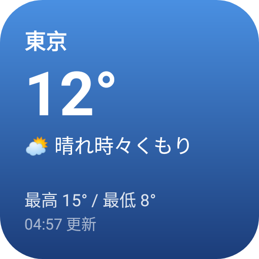
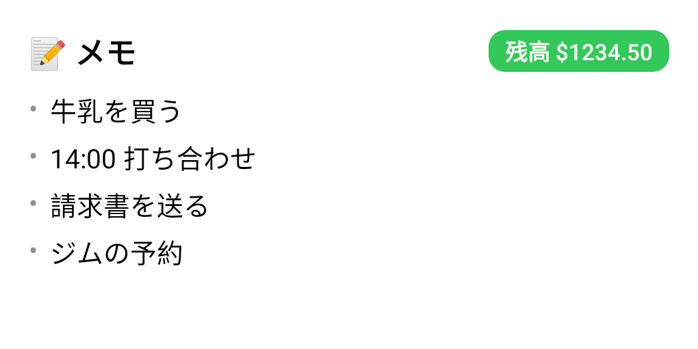

# コードウィジェット（Android）

Scriptable のように「JavaScript を貼り付けるだけ」でホーム画面ウィジェットを作れる Android アプリです。
Scriptable と同じ書き方（`ListWidget`、`addText`、`addStack`、`Request` など）に対応しているので、
iPhone で使っていたスクリプトをほぼそのまま動かせます。

<p>
  
  
</p>

## ダウンロード

[Releases](../../releases) から最新の `CodeWidget.apk` をダウンロードしてください（Android 8.0 以上）。

## 使い方

1. `CodeWidget.apk` をスマホに入れます（「提供元不明のアプリ」のインストールを許可してください）。
2. アプリを開き、「📋 貼り付けて作成」を押します。クリップボードのコードがエディタに入ります。
3. 「▶ 実行」で見た目を確認し、「💾 保存」します。
4. ホーム画面を長押し →「ウィジェット」→「コードウィジェット」を置き、表示するスクリプトを選びます。

- 約 15 分ごとに自動で更新されます。ウィジェットをタップすると、その場で更新されます（`widget.url` を指定した場合は、そのURLが開きます）。
- サイズは自由に変えられます。`config.widgetFamily` は幅と高さから `small` / `medium` / `large` が自動で決まります。
- API キーは「⚙️ 設定 → Keychain」に保存し、スクリプトでは `Keychain.get("キー名")` で読み出せます。

## 対応している主な API

| 種類 | 対応しているもの |
|---|---|
| ウィジェット | ListWidget, WidgetStack, WidgetText, WidgetDate, WidgetImage, WidgetSpacer, setPadding, backgroundColor / Gradient / Image, cornerRadius, borderWidth, size, spacing, url, refreshAfterDate |
| 見た目 | Color（`Color.dynamic` を含む）, Font（system / monospaced / rounded / 太さ指定 / title1 など）, LinearGradient, DrawContext, Path, SFSymbol（よく使うものは絵文字で代用） |
| 通信 | Request（loadJSON / loadString / loadImage / load、POST・ヘッダー指定）, fetch |
| 保存 | Keychain, FileManager.local() / iCloud()（どちらも端末内に保存）, Data, Image |
| その他 | Location（アプリで位置情報を許可）, Device, DateFormatter, RelativeDateTimeFormatter, args.widgetParameter, config, Script, importModule, console.log |
| 未対応 | Calendar, Reminder, Photos, Contact, Notification（何もしない）, Alert（表示されない）, WebView, UITable |

## 自動更新が止まるとき

Xiaomi、OPPO などの機種は省電力機能が強いため、自動更新が止まることがあります。
「⚙️ 設定 → 電池の最適化を解除する」で、このアプリを「最適化しない」に設定してください。

## ビルド方法（開発者向け）

```bash
./gradlew assembleRelease
```

- 必要なもの：JDK 17 以上、Android SDK（platform 35）。`local.properties` に `sdk.dir=<Android SDK の場所>` を書くか、環境変数 `ANDROID_HOME` を設定してください。
- GitHub Actions：`main` への push ごとに APK を作成します。`v0.1.2` のようなタグを push すると Releases に公開されます。
- 署名：リポジトリの Secrets に `SIGNING_KEYSTORE_B64`（keystore を base64 にしたもの）、`SIGNING_STORE_PASSWORD`、`SIGNING_KEY_ALIAS`、`SIGNING_KEY_PASSWORD` を登録すると、その鍵で署名します。未登録の場合は毎回異なる debug 鍵で署名されるため、更新時はアンインストールが必要です。
- アプリ本体：`app/src/main/java/com/codewidget/app/`
- Scriptable 互換ランタイム：`app/src/main/assets/runtime.js`
- 描画エンジン：`WidgetRenderer.kt`（ウィジェットの内容を 1 枚の画像に描いて表示します）

## ライセンス

[MIT License](LICENSE)
